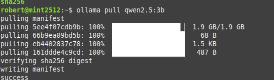

# Qwen 2.5 Model Comparison

## Goal

I tested two locally running Qwen 2.5 model sizes to see how they answered a cybersecurity question.

## Test prompt

I asked both models:

> Explain the CIA triad in cybersecurity.

## Results

| Model | Recorded result |
| --- | --- |
| `qwen2.5:0.5b` | Described categories of threats instead of identifying the three principles of the CIA triad. |
| `qwen2.5:3b` | Identified and explained confidentiality, integrity, and availability. |

The CIA triad refers to **confidentiality, integrity, and availability**.

## What I learned

Both models generated responses, but their answers to this question differed in accuracy. This reminded me that a model running successfully does not guarantee that its answers are correct.

This was one informal test, not a comprehensive benchmark. Different prompts or repeated runs could produce different results.

## Commands

```bash
ollama run qwen2.5:0.5b
ollama run qwen2.5:3b
```
## Model Download

This screenshot shows the successful download of the Qwen 2.5 3B model.



[Back to the project overview](../README.md)
